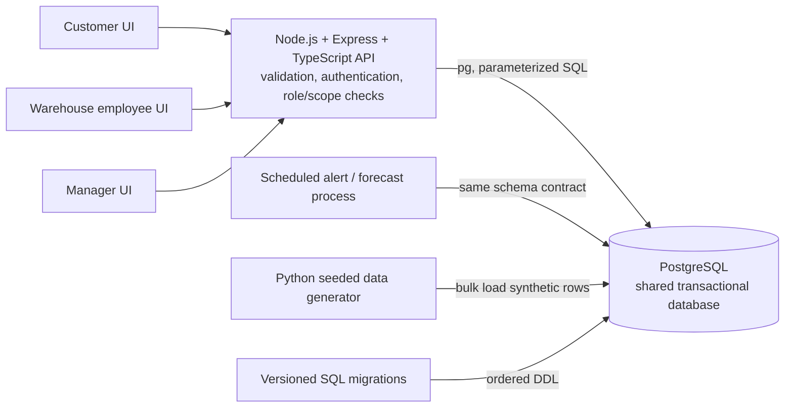

# Database Midterm Plan

**Project:** Multiwarehouse Order Fulfillment and Returns  
**Owner:** Member 1 — database design, migrations, shared database foundation, and synthetic data  
**Status:** design approved; estimates are planning assumptions until generator pilot/load measurements.

## Data volumes and sources

The source project plan targets three warehouses, about 500 products, about 50,000 generated customers, about 400,000 orders across five simulated years, and at least 1,000,000 order-item rows (about 2.5 lines per order on average). Orders and their dependent operational records will be generated from a fixed seed and workflow rules. Product catalog selection is not finalized; use a collected public catalog with source/collection date and clearly marked synthetic variants, or a labeled synthetic catalog if no suitable source is selected. No real customer data is planned.

Counts below are estimated row counts, not loaded measurements. Derived volumes and rates are provisional pending a generator pilot. “Scenario-derived” rows come from valid generated workflow events, not independent random status assignment.

| Table | Planning rows | Source / estimation basis |
|---|---:|---|
| `users` | ~50,100 | Generated customer accounts plus ~100 staff/manager demo accounts; synthetic only. |
| `customers` | ~50,000 | Generated profiles, linked 1:1 to customer-role users. |
| `warehouses` | 3 | Three fixed synthetic locations. |
| `warehouse_memberships` | 99 | Generated employee assignments across three warehouses; manager scope is global in this draft. |
| `products` | ~500 | Collected catalog if source is approved; otherwise labeled synthetic catalog. |
| `lots` | 1,000 | Generator creates two traceable lots per product; each lot can be stocked at all three warehouses. |
| `inventory_balances` | 3,000 | Two lots × 500 products × three warehouses in the default profile. |
| `orders` | 400,000 | Generated over five years with Zipf-skewed customer frequency and time-of-day/week/season patterns. |
| `order_items` | 1,000,000 | Default generator profile uses 2 or 3 distinct product lines per order; cancellation is recorded at line level. Primary scale table. |
| `allocations` | ~1,000,000–1,050,000 | Derived from generated order lines; baseline one allocation per line, occasional lot splits if needed. |
| `shipments` | ~400,000–800,000 | Derived from warehouse groups per fulfilled order; splits can create multiple shipments per order. |
| `shipment_items` | ~980,000–1,000,000 | Derived from allocations actually shipped; fully cancelled lines produce no shipment item. |
| `shipment_events` | ~1,200,000–2,400,000 | Scenario-derived, provisionally 3–6 lifecycle events per shipment. |
| `returns` | ~60,000 | Scenario-derived at approximately 6% of shipped item lines; one synthetic return per selected shipment line. |
| `return_items` | ~60,000 | One item line per generated return in the current baseline. |
| `return_inspections` | ~60,000 | One inspection per generated return item in the current baseline. |
| `transfers` | Up to 500 | Completed synthetic inter-warehouse movements; generator skips a transfer if it cannot find safe source stock. |
| `transfer_items` | Up to 500 | One lot line per completed generated transfer. |
| `transfer_events` | Up to 2,000 | Four lifecycle events per completed transfer. |
| `stock_movements` | ~2,010,000–2,200,000 | Initial receipts, reservations, cancellations, dispatch, transfer, and return events; exact count follows generated splits/returns. |
| `alerts` | 1,500 | Scenario evidence for low-stock, imbalance, and lot-quality review; repeated active keys are deduplicated. |
| `audit_log` | ~800,000–1,200,000 | Generated order, shipment, and transfer write records. |
| `purchase_orders` | 60 | Synthetic replenishment schedule: 20 periods per warehouse. |
| `po_items` | 1,500 | 25 product lines per purchase order in the default profile. |
| `cycle_counts` | 3 | Final count snapshot, one per warehouse. |
| `cycle_count_items` | Up to 300 | Up to 100 lot balances sampled per warehouse. |
| `reservation_holds` | 0 baseline; up to ~100,000 | Optional feature. Generate only if the team adopts checkout holds; do not reserve again when converting to allocations. |
| `demand_forecasts` | 30,000 | Twenty quarterly horizons × 500 products × three warehouses in the default profile. |
| `recalls` | 25 | Synthetic investigation cases; these are not assertions of confirmed defects. |

The default generator creates 50,100 users (50,000 customers, 99 employees, one manager) with synthetic, unusable generated credentials. Run `npm run db:seed` after the scale load if demo login accounts are needed.

These estimates are deliberately not a storage guarantee. The original plan’s 256 MB figure is a recommendation; lot-level balances and append-only movement/audit history can exceed it. A pilot must report actual counts, table/index sizes, and load duration before hosting is selected.

## Database architecture

All three warehouses live in one PostgreSQL database. The API owns request validation and authorization; PostgreSQL transactions and constraints protect shared state. Scheduled jobs are separate processes, not one copy per web worker. The generator and migrations use separate commands/configuration so a data load cannot accidentally replace a production database.

## Role read/write matrix

These are application permissions; a hidden UI control is not enforcement. Every request must also enforce customer ownership or assigned warehouse scope. The table below describes intended allowed operations, not direct end-user database credentials.

| Data area | Customer | Warehouse employee | Manager |
|---|---|---|---|
| Public product catalog | Read active products and indicative availability | Read catalog and assigned-warehouse availability | Read catalog and network availability |
| Own account/customer profile | Read/update own permitted profile fields | No customer profile access by default | Read customer details only when needed for investigation |
| Orders/order items | Read own orders; request order/cancel within eligibility | Read assigned warehouse work needed to fulfill | Read all orders and operational reports |
| Allocations/inventory | Read only availability summary; no balances or other customers’ reservations | Read assigned warehouse balances/queues; workflow writes occur through approved operations | Read network balances; approve policy-controlled corrections |
| Shipments/events | Read shipments for own orders | Create/update handling and simulated dispatch events at assigned warehouse | Read all; manage exceptions |
| Returns/inspection | Create and read own return requests | Receive and inspect assigned warehouse returns | Read all; review exceptions and quality signals |
| Transfers | No access | Read assigned transfer work; record local pick/dispatch/receipt actions | Read network; create/approve transfer decisions |
| Alerts/recalls | No access | Read actionable alerts for assigned warehouse; no global resolution | Read, assign, investigate, quarantine/resolve through workflow |
| Purchase orders/counts/forecasts | No access | Assigned warehouse receiving/count tasks as granted | Network read and approvals |
| Users/memberships/audit | No access | No account administration; own actions appear in audit | Manage permitted accounts/scope and inspect audit history |

Customer order creation and employee/manager business operations belong to other team members. This schema work supplies the shared structures and permission contract only.

## PostgreSQL choice

PostgreSQL is a good fit for this workload because the core data is relational and requires enforceable foreign keys, uniqueness, checks, and multi-row transactions. Inventory reservation, cancellation, transfer dispatch/receipt, and return inspection can update balances and append history atomically. B-tree indexes support customer history, warehouse queues, and lot traceability; `EXPLAIN (ANALYZE, BUFFERS)` supports the course’s query-plan evidence. `jsonb` is limited to evolving evidence/event payloads while ownership, quantities, states, and joins remain typed columns. The selected stack already uses Node.js/TypeScript and `pg`, and PostgreSQL can run locally and on hosted services.

## Design alternative considered

**Alternative:** derive current stock by summing an append-only stock ledger for every availability request, with no mutable balance row.

**Chosen:** keep one mutable `inventory_balances` row for each `(lot_id, warehouse_id)` as the transactional current balance, alongside immutable `stock_movements` as the explanation and reconciliation history. Reservation can lock the narrow balance row and check available units without repeatedly aggregating the full movement history; the ledger retains traceability. The tradeoff is that every stock-changing operation must update the balance and append its movement in the same transaction, and reconciliation is needed to detect implementation defects.

## Assumptions and open decisions

- Three warehouses and the October 2026 project summary’s baseline volumes are accepted planning inputs.
- The product domain/catalog source, expiry coverage, and reuse terms remain to be selected.
- Return, alert, transfer, movement, and audit rates above are explicit pilot assumptions, not requirements or observed data.
- `unavailable` is one disjoint quantity bucket in this schema. Confirm whether to add finer-grained quarantine/damage/inspection quantities or keep detail in lot, return, and movement records.
- Confirm whether replacement orders, recalls, purchase orders, cycle counts, and checkout holds are in the team’s committed demo scope. Their supporting tables are included to reflect the supplied ER concepts, but feature behavior is outside this tranche.
- Allocation preference, stock-cover thresholds, transfer lead times, return eligibility, and exact lifecycle states need team agreement before workflow implementations depend on them.
- PostgreSQL 13+ is required for `gen_random_uuid()` and stored generated columns as used here. Confirm the target host version before deployment.
